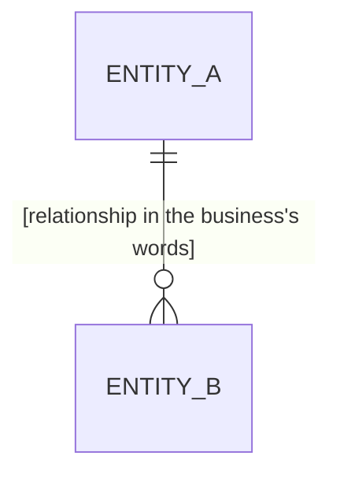

# Entity Model

## Entity Relationship Diagram

### ENTITY_A

[One sentence: what this entity is, told apart from its neighbors.]

**Not:** [Synonyms to avoid; omit when none]

| Attribute | Meaning | Type | Rules |
|---|---|---|---|
| reference | [How the business names this entity] | Identifier | Unique, never reused |
| name | [What the name means to the business] | Text | Required |

### ENTITY_B

[One sentence: what this entity is.]

| Attribute | Meaning | Type | Rules |
|---|---|---|---|
| reference | [How the business names this entity] | Identifier | Unique, never reused |
| entity_a | [The ENTITY_A this belongs to] | Reference to ENTITY_A | Required |
| status | [Where it stands] | Choice of First, Second, Third | Required |

**Lifecycle:** First → Second → Third

**Constraints:** [A rule spanning attributes; omit when none]
