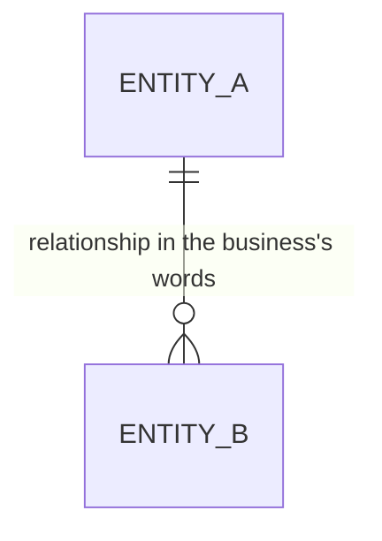

# Entity Model

## Entity Relationship Diagram

### ENTITY_A

[One sentence: what this entity is, told apart from its neighbors.]

**Not:** [synonyms that must not be used; delete the line when there are none]

| Attribute | Description | Data Type | Length/Precision | Validation Rules |
|-----------|-------------|-----------|------------------|------------------|
| id | Unique identifier | Long | 19 | Primary Key, Sequence |
| name | [What the value means to the business] | String | 100 | Not Null |

### ENTITY_B

[One sentence.]

| Attribute | Description | Data Type | Length/Precision | Validation Rules |
|-----------|-------------|-----------|------------------|------------------|
| id | Unique identifier | Long | 19 | Primary Key, Sequence |
| entity_a_id | [The ENTITY_A this belongs to] | Long | 19 | Not Null, Foreign Key (ENTITY_A.id) |
| status | [Where it stands] | String | 20 | Not Null, Values: First, Second, Third |

**Lifecycle:** First → Second → Third

**Constraints:** [A rule that spans attributes; delete the line when there is none.]
